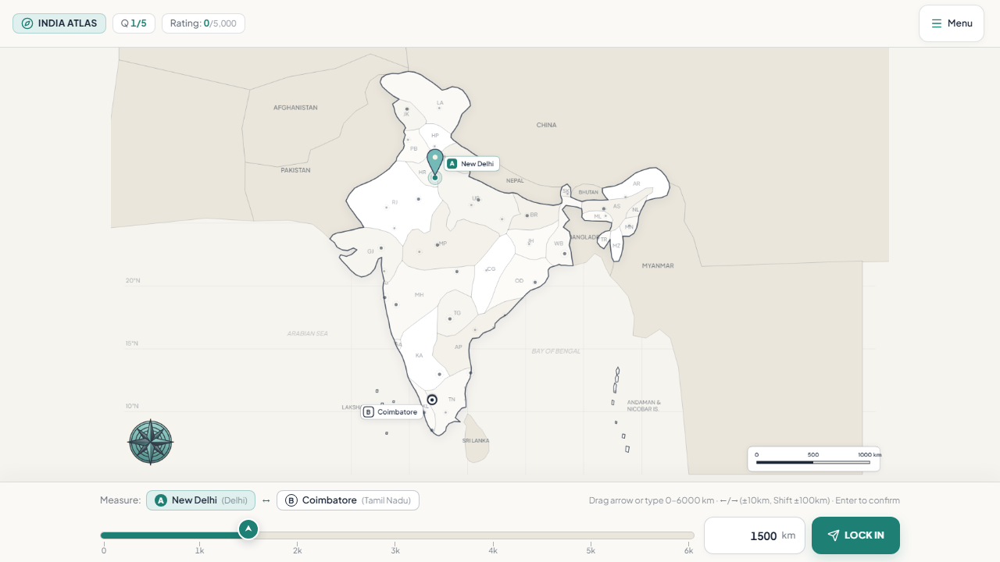

# 🗺️ India Atlas — Distance Cartography & KM Guessing Game

[](https://ranveeramilkanthwar-cyber.github.io/india-atlas-quiz/)
[](https://react.dev/)
[](https://www.typescriptlang.org/)
[](LICENSE)

> An authentic, physics-driven cartographic geography game where players explore sovereign India, estimate straight-line geodesic distances between cities, and master the scale of the Indian subcontinent.

---

## 🎮 Play Online Now

👉 **[Launch Live Game on GitHub Pages](https://ranveeramilkanthwar-cyber.github.io/india-atlas-quiz/)**

---

## 📸 Game Preview



---

## ✨ Key Features

### 🏛️ Authentic Sovereign Cartography
- **Sovereign Mainland Borders**: High-fidelity polyline representation of the Republic of India's external sovereign boundaries.
- **Accurate State & UT Boundaries**: Features distinct regional fills, hairline administrative borders, and official state abbreviations for all Indian states and union territories.
- **Island Archipelagos**: Includes the Andaman & Nicobar and Lakshadweep islands.
- **Subcontinental Topography**: Includes neighboring countries (Sri Lanka, Nepal, Bhutan, Bangladesh, Pakistan, Myanmar, Tibetan Plateau) rendered in serene cartographic tints.
- **Cartographic Graticule**: Latitudinal and longitudinal parallels (10°N – 35°N, 70°E – 95°E) with nautical coordinate markings.

### ⚙️ Real-World Physics Engine (60 FPS)
- **Kinetic Slider Throw & Friction**: The kilometer estimation slider features inertial fling physics—flick the slider to throw it with velocity, smoothly decelerating under viscous drag:
  $$v_{t+1} = v_t \cdot (1 - \mu \cdot \Delta t)$$
- **Spring Boundary Recoil**: Hitting the slider limits ($0\text{ km}$ or $6,000\text{ km}$) triggers an elastic boundary bounce governed by damped harmonic spring physics:
  $$F = -k \cdot x - c \cdot v$$
- **Pin Drop Gravity & Restitution Bounce**: When target cities spawn, pins fall under downward gravitational acceleration ($g = 1,800\text{ px/s}^2$), bouncing upon impact with restitution ($e = 0.50$) and squash-and-stretch deformation.
- **Magnetic Compass Rose**: Floating directional compass reacts dynamically with angular momentum and damped magnetic alignment.
- **Celebration Particle Dynamics**: Round completions fire celebratory confetti particles with air drag and gravitational arc trajectories.

### 📐 Precision Geodesic Mathematics
- Accurate Great-Circle calculation using the **Haversine formula**:
  $$d = 2R \cdot \arcsin\left(\sqrt{\sin^2\left(\frac{\Delta\phi}{2}\right) + \cos(\phi_1)\cos(\phi_2)\sin^2\left(\frac{\Delta\lambda}{2}\right)}\right)$$
- Animated distance ruler sweep connects City A and City B upon guess submission with real-time measurement badge reveal.
- Exponential accuracy scoring awarding up to **1,000 rating points** per question.

---

## 🕹️ How to Play

1. **Inspect the Map**: Two cities (**City A** in teal and **City B** in ink) are marked with municipal boundary rings on the map of India.
2. **Estimate the Distance**:
   - Drag or flick the **Kinetic Distance Slider** to adjust your kilometer guess.
   - Use the **`+100` / `+10` / `-10` / `-100`** nudge buttons for fine precision.
   - Gauge your estimate against the map's graticule lines and geographical landmarks.
3. **Lock In Guess**: Click **LOCK IN** or press `Enter` to reveal the true straight-line distance.
4. **Analyze the Measurement**: Watch the cartographic ruler sweep between both cities to inspect the straight line and see your accuracy rating.
5. **Complete the Expedition**: Complete a sequence of questions to achieve a high rating and claim your Cartographer title!

---

## 🛠️ Tech Stack

| Technology | Purpose |
| :--- | :--- |
| **React 19** | Modern reactive component architecture & lifecycle hooks |
| **TypeScript** | Strict compile-time type safety across all geo-coordinates and state |
| **HTML5 Canvas 2D** | 60 FPS hardware-accelerated vector cartography & custom projection |
| **Tailwind CSS** | Clean minimalist typography, utility classes, and responsive layout |
| **Lucide Icons** | Elegant iconography for UI actions and navigation |
| **Web Audio API** | Procedural acoustic sound design (crisp clicks, measurement swooshes, success bells) |
| **esbuild** | Sub-second bundling into an optimized, self-contained distribution |
| **GitHub Pages** | Fast, serverless global edge hosting |

---

## 📁 Repository Structure

```
├── assets/
│   ├── audio/              # Sound effects & ambient cartography background score
│   └── images/
│       ├── city_pin_marker.png     # Custom high-res city pin asset
│       ├── compass_rose_icon.png   # Hand-drawn antique compass rose
│       └── preview.png             # Live gameplay preview screenshot
├── utils/
│   ├── BackgroundMusic.tsx # Web Audio ambient synthesizer
│   ├── helper.tsx          # Canvas utilities, audio synthesizers, math helpers
│   ├── index.ts            # Utility exports
│   └── usePlayground.ts    # Game lifecycle & resume state hooks
├── App.tsx                 # Core game view, 60fps canvas loop & physics engine
├── build.js                # esbuild automated build script
├── constants.ts            # Color palettes, cartography theme & default configs
├── index.html              # HTML5 root entry point for GitHub Pages
├── index.tsx               # React root mount entry point
├── indiaGeoData.ts         # Coordinates for sovereign borders, states, & 30+ Indian cities
├── package.json            # Project manifest & npm scripts
├── tsconfig.json           # TypeScript configuration
└── .nojekyll               # GitHub Pages static asset bypass configuration
```

---

## 🚀 Getting Started Locally

### Prerequisites
- [Node.js](https://nodejs.org/) (version 18 or higher recommended)
- `npm`

### Installation

1. **Clone the repository**:
   ```bash
   git clone https://github.com/ranveeramilkanthwar-cyber/india-atlas-quiz.git
   cd india-atlas-quiz
   ```

2. **Install dependencies**:
   ```bash
   npm install
   ```

3. **Build the production bundle**:
   ```bash
   npm run build
   ```

4. **Serve the project locally**:
   ```bash
   npx serve .
   ```
   Open [http://localhost:3000](http://localhost:3000) in your browser.

---

## 👤 Author & Contribution

- **Ranveer Amilkanthwar**
  - GitHub: [@ranveeramilkanthwar-cyber](https://github.com/ranveeramilkanthwar-cyber)
  - Email: [ranveeramilkanthwar@gmail.com](mailto:ranveeramilkanthwar@gmail.com)

---

## 📄 License

This project is licensed under the ISC License.
